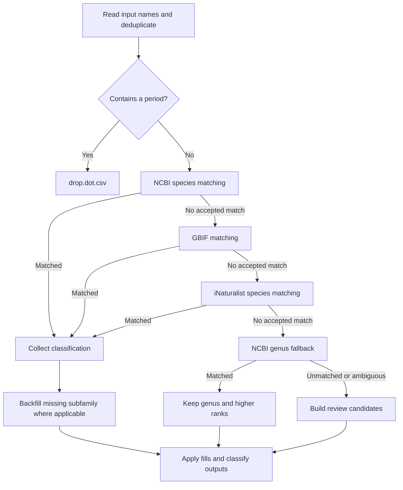

# Taxonomic name reconciliation

This directory contains the scripts used to reconcile source taxonomic names and retrieve classification information for iLepBase. The main Python workflow queries **NCBI Taxonomy → GBIF → iNaturalist**, then attempts an **NCBI genus-level fallback** if species-level matching fails. It preserves an input-name-to-standardized-name mapping and writes separate processing and review tables.

This README documents the implementation in [`clean_species.py`](clean_species.py). It distinguishes automated matching, suggested review candidates, and manual curation; these are not interchangeable evidence of a confirmed taxonomic assignment.

## Files and published data

| File | Role |
| --- | --- |
| [`clean_species.py`](clean_species.py) | Python command-line workflow described below. |
| [`0.species_name_clean.R`](0.species_name_clean.R) | Earlier, interactive R workflow using `taxize`. See the historical workflow section. |
| [`../../Taxonomy/lep_taxo_20260518.tsv`](../../Taxonomy/lep_taxo_20260518.tsv) | Published name-mapping snapshot, including input names, standardized names, classification, source links, and notes. |

The published TSV is a retained data snapshot, not a claim that a fresh run against current upstream APIs will reproduce every row. Live source content, input preparation, and subsequent curation can affect results. The Python script writes CSV outputs; it does not directly generate the published TSV or deploy records to the website.

## 1. Input and output fields

### Supported input formats

Run from the repository root. Input paths are resolved relative to the working directory.

- Excel: `.xlsx`, `.xlsm`, `.xltx`, `.xltm`; select the worksheet with `--sheet-name`.
- Text: `.csv` uses commas; `.tsv` and `.txt` use tabs. Text files are read as UTF-8, with an optional byte-order mark.
- The first row must contain column headers. **`origin Species` is the input-name column**; rows with an empty value in this column are ignored.
- Additional taxonomy columns may be supplied. Missing expected columns become empty strings. Unrecognized columns are not carried through to the outputs.
- Legacy `.xls` files are not supported by the Python reader.

A minimal CSV input is:

```csv
origin Species
Bombyx mori
Danaus plexippus
Papilio sp.
```

### Full field dictionary

The historical spellings `subfamliy` and `genuis` are retained for compatibility. Use these exact headers when providing existing classification values.

| Column | Meaning |
| --- | --- |
| `origin Species` | Original input name retained in the mapping table. |
| `family`, `fid` | Family name and associated source identifier. |
| `subfamliy`, `sfid` | Subfamily name and associated source identifier. |
| `genuis`, `gid` | Genus name and associated source identifier. |
| `species`, `sid` | Standardized taxon name and source identifier selected by the workflow. Check the matching rank and notes before interpreting every value as a confirmed species assignment. |
| `authority` | Authorship extracted from the selected source where available. |
| `basionym` | Original combination extracted from the NCBI Taxonomy Browser where available; not a complete synonym list. |
| `source` | Principal matching source: `ncbi`, `gbif`, or `inaturalist`. |
| `source link` | Source record URL; multiple links can be separated by semicolons. |
| `note` | Processing annotations, or a simplified reason in review tables. |

`source (ncbi gbif)` is accepted as an alias for `source`.

Identifiers are **source-specific**, not a universal identifier system. For example, `sid` may contain an NCBI TaxID, a GBIF identifier, or an iNaturalist taxon ID. Higher-rank fields may be supplemented from another source; do not infer their identifier namespace from `source` alone. Follow the record links and processing notes.

### Preservation and deduplication

Input values are converted to text and stripped of leading/trailing whitespace. Query and deduplication keys additionally collapse repeated whitespace and ignore letter case. The first input row for each normalized name supplies the base record. Unique names are sorted alphabetically before processing; outputs contain one row per processed normalized input name, not one row per original observation or literature record.

The script does not replace `origin Species` with the matched name. Consequently, the table retains the correspondence between the retained input name and the standardized result. This is not byte-for-byte preservation of raw source text, and it does not guarantee that every downstream data product retains its own original-name field.

## 2. Processing workflow



Here, “accepted match” means a match admitted by the script's rules, not an independently adjudicated nomenclatural acceptance decision. Output classification also includes the candidate-enrichment behavior described in section 6.

### 2.1 Names containing periods

Any input name containing `.` is assigned `skip_dot` and routed to `.drop.dot.csv` without querying the taxonomic sources. This includes provisional designations such as `Papilio sp.`, but the rule is broader: a period in an author abbreviation or another part of the name also triggers it. These names require separate examination rather than an assumption that they are invalid taxa.

### 2.2 NCBI Taxonomy: first source

1. Search Taxonomy using a quoted scientific-name query (`"name"[SCIN]`). If no IDs are returned, retry without quotes (`name[SCIN]`).
2. Retrieve returned taxa and lineage information with EFetch.
3. Prefer a unique species-rank result whose full name, or first two whitespace-separated words, matches the query after case/whitespace normalization.
4. If no species-rank result matches, consider matching returned taxa without restricting rank. A unique such result can also be returned as a match; multiple matching results are ambiguous.
5. If multiple returned taxa remain at the ambiguity check, the method returns ambiguous before the edit-distance branch. Otherwise, enabled fuzzy matching may admit a unique species-rank candidate.
6. Retrieve family, subfamily, genus, identifiers, and available authorship. Attempt to extract `basionym` from the NCBI Browser page. A missing page field, parser mismatch, or retrieval error leaves `basionym` empty without rejecting the classification match.

An admitted NCBI match ends the species-source search. GBIF and iNaturalist are not then queried to independently validate that species name.

### 2.3 GBIF: second source

If NCBI does not produce an admitted match, call the GBIF species-match endpoint. The automatic GBIF branch requires all of the following:

- A `usageKey` is present and `matchType` is not `NONE`.
- `matchType` is **`EXACT`**.
- `confidence` is **at least 95**.
- The returned canonical name equals the query after normalization, or is within the configured edit-distance threshold.
- The returned `alternatives` list is empty.

The canonical comparison uses `canonicalName`, then `species`, then the first two words of `scientificName`. A GBIF result labelled `FUZZY` does **not** pass merely because its spelling is close: the `EXACT` requirement still applies.

For an admitted match, the script retrieves the `usageKey` record and builds classification fields. The output name uses `species`, then `canonicalName`, then the first two words of `scientificName`; `sid` uses `speciesKey` when present. The source link points to the retrieved usage record, which need not have the same ID as `sid`.

This implementation does not explicitly follow `acceptedUsageKey` or require a particular taxonomic acceptance status. Its output should therefore be described as a standardized name from the selected record, rather than a guarantee of comprehensive accepted-name resolution.

### 2.4 iNaturalist: third source

If GBIF does not produce an admitted match, search the iNaturalist autocomplete endpoint with `rank=species`, the Lepidoptera taxon filter (`47157`), and up to ten returned suggestions.

- The exact branch requires one active name match and exactly one species candidate in the returned candidate list.
- Name comparison uses the same full-name/first-two-word rule as the NCBI branch.
- With fuzzy matching enabled, a unique active fuzzy candidate can be selected even when other nonmatching candidates are present.
- Fetch the selected taxon and verify Lepidoptera ancestry before building classification fields.
- This branch leaves `authority` and `basionym` empty.

The retrieved candidates are autocomplete results, not an exhaustive search of all taxonomic names.

### 2.5 NCBI genus fallback

If all three species-source branches fail, take the first word of the input name and query it as an NCBI genus. A unique, exact, genus-rank match supplies the genus and available higher classification; `species` and `sid` remain empty in the generated fill. The note is `genus_fallback`.

A successful genus fallback returns before unresolved-review events are created. Thus, genus-only results are not automatically included in the genus-review table. A genus assignment must not be interpreted as a resolved species assignment.

## 3. Spelling differences, synonyms, and names below species rank

### Spelling differences

The default `--fuzzy-max-dist 2` enables a Levenshtein edit-distance threshold of two character insertions, deletions, or substitutions after case/whitespace normalization. It compares candidates already retrieved from a source; it is not an independent search over all possible corrected spellings.

When a fuzzy match is admitted, the script adds a note such as:

```text
fuzzy_match_accepted(Acleris nigrilinea->Acleris nigrilineana)
```

Set `--fuzzy-max-dist 0` to disable this edit-distance step. Full-name normalization and first-two-word comparisons remain active. Edit distance is a spelling heuristic, not evidence that two names are taxonomic synonyms. Close names and homonyms require taxonomic review.

### Synonyms, historical names, and revised combinations

The published mapping table can contain different input and standardized names. For example, it records `Abagrotis barnesi → Abagrotis orbis` and `Abromias syriaca → Apamea syriaca`, with GBIF source links. These are examples from the retained snapshot, not promises about fresh API results.

The Python script does **not** build a complete synonym graph, extract every NCBI alternative-name category, or explicitly traverse GBIF accepted-name relationships. Apart from extracting authorship, it does not use NCBI `OtherNames` as a synonym-matching dictionary. `basionym` stores one available original-combination field, not all historical combinations or synonyms.

Name differences may arise from source records, spelling normalization, rank aggregation, or curation. A difference between `origin Species` and `species` should not automatically be labelled a synonym relationship.

### Subspecies and other multiword names

NCBI and iNaturalist name comparisons can use the first two words of a longer name. GBIF output may likewise use a species-level field. This supports species-centered aggregation of some subspecies or other multiword inputs, but is not a dedicated subspecies parser or a uniform rule that all subspecies are collapsed correctly.

A unique NCBI match can also retain a non-species rank through its second matching pass. Check the source record and identifiers before treating such output as strictly species-level. Preserve the input name and record any manual rank decisions; aggregation to a species does not establish synonymy.

## 4. Backfilling missing subfamily information

After the initial batch of resolutions, rows whose principal source is **GBIF**, with a genus but no subfamily, are supplemented in this order:

1. **Same-genus donor:** use the first resolved row in the processed, alphabetically ordered batch with the same normalized genus and a nonempty subfamily name and ID. Copy the subfamily and, when available, the donor's family fields. Add `subfamily_backfilled_from_same_genus`. This is a within-batch transfer, not independent confirmation or a consensus across conflicting donors; no donor URL is added by this step.
2. **NCBI genus lineage:** query the genus. A unique match, or a unique Lepidoptera lineage among ambiguous genus candidates, can supply family/subfamily values. Add `subfamily_backfilled_from_ncbi_genus` and its source link when a subfamily is filled. Ambiguity or missing subfamily in the relevant ambiguous case can create a review event.
3. **iNaturalist genus lineage:** use a unique active genus match with Lepidoptera ancestry. Add `subfamily_backfilled_from_inat_genus` and its link when a subfamily is filled. Retrieval errors in this final supplementation step are caught and do not stop the run.

These steps can replace family fields even though the species source remains GBIF. Missing subfamily alone does not remove a row from the species output: it is additionally listed for subfamily review. Other principal sources are not passed through this GBIF-specific backfill chain.

## 5. Existing values and source priority

By default, nonempty input classification values are retained and only missing fields are filled. `--overwrite-existing` allows nonempty generated values to replace them; an empty generated value never clears an existing input value. In either mode, source links and notes are merged rather than simply overwritten. The input file itself is not modified.

Therefore, **NCBI → GBIF → iNaturalist** describes the automatic lookup order. It is not a three-source voting system, and it does not guarantee that all final fields came from one source. Existing values, backfilled higher ranks, and subsequent manual decisions must also be considered.

`--skip-filled` omits rows for which all of the following are nonempty: `family`, `fid`, `subfamliy`, `sfid`, `genuis`, `gid`, `species`, `authority`, `sid`, and `source`. It does not require `basionym` or `source link`. Skipped rows are **not copied to this run's output files**; retain the original table when using this option.

## 6. Review candidates and manual curation

When the species chain and genus fallback both fail, the script creates review events and can recommend a returned candidate. Candidate ranking uses name agreement, expected rank, and, for iNaturalist, active status. These recommendations are automated suggestions.

**Important implementation detail:** before assigning final output tables, unresolved rows are enriched from their primary recommended candidate where possible. If the enriched row has a nonempty species name and no runtime-error review event, it can be promoted into `.clean.sp.csv`; `no_match` and `review_needed` notes are removed. A genus value is not required by this promotion check. This happens automatically and does not constitute a recorded manual approval. If the promoted row lacks a subfamily, it is also written to the subfamily-review table. The `.clean.sp.csv` filename alone is therefore not evidence that every row passed the original strict match rules or received expert review.

Unpromoted unresolved rows whose primary reason is ambiguous genus candidates go to `.review.genus.csv`; other unresolved cases go to `.review.none.csv`. Review rows can contain suggested classification values and should not be interpreted as confirmed assignments merely because some fields are populated.

Review CSVs retain a reduced set of columns and simplify the reason to `no subfamily`, `genus ambiguous`, or `no match`. They do not export the complete candidate list or every internal review event. Runtime errors are counted separately, although their review-table reason is simplified as well.

The script does not implement an interactive manual-review application or automatically re-import human decisions. For a curated release, inspect the relevant source records, retain the curator's changes and evidence separately, and explicitly document which output rows were included or excluded. Running the script alone does not establish that all unresolved records were manually reviewed or excluded from downstream integration.

## 7. Output tables and interpretation

For `--output-prefix results/taxonomy`, the script writes the following files. Output directories are created as needed. Existing files at the same paths are replaced.

| Suffix | Contents |
| --- | --- |
| `.drop.dot.csv` | Names containing a period; skipped by the automatic lookup chain. |
| `.clean.sp.csv` | Rows with a populated species field, including eligible promoted candidates and rows still missing a subfamily. This is an output bucket, not an assurance of independent expert verification. |
| `.clean.genus.csv` | Non-unresolved-review rows with a populated genus but no species, typically genus fallback results. Existing input values can affect routing. |
| `.review.genus.csv` | Unresolved-review rows whose primary event is ambiguous genus candidates, provided there is no runtime-error event. |
| `.review.subfamily.csv` | Additional review list for rows admitted to the species output but still lacking a subfamily. These rows overlap `.clean.sp.csv`. |
| `.review.none.csv` | Remaining unresolved, unmatched, or runtime-error review rows. Suggested values can already be present in these rows. |
| `.counts.json` | Input/output counts and a partition consistency check. |

The three `review.*.csv` files use UTF-8 with a byte-order mark for spreadsheet compatibility and contain `origin Species`, `family`, `fid`, `subfamliy`, `genuis`, `species`, `source`, `source link`, and `note`. Their notes are simplified to `genus ambiguous`, `no subfamily`, or `no match`; they do not export the complete internal event history or all candidates. Other CSV outputs use the full field set and UTF-8 encoding.

The count check requires:

```text
input_total = drop_dot + cleaned_sp + cleaned_genus + review_genus + review_none
```

`review_subfamily` is excluded from this sum because it overlaps the species table. `input_total` counts unique processed names after filtering and any limit; `loaded_rows` counts nonempty input-name rows before deduplication. A mismatch raises an error after CSV files have been written, before the normal counts JSON is saved. Internal match-status counts printed to the console can differ from final bucket counts because of enrichment and retained input values.

Manual review and release preparation are separate steps. Inspect candidate identity, rank, source links, fuzzy matches, cross-source classification changes, and unresolved records; retain the evidence and decisions in a separate curation log. This script does not provide an interactive approval screen or automatically import a completed review sheet. A review file is a worklist, not proof that every listed name has been reviewed. The script also does not itself decide which unresolved records a final iLepBase release includes or excludes.

## 8. Installation and commands

Requirements: **Python 3.11+**, `httpx`, and `openpyxl`. The script also declares its dependencies as inline metadata for `uv`.

Install dependencies into your chosen Python environment:

```bash
python -m pip install httpx openpyxl
python script/taxonomy/clean_species.py --help
```

Start with a small run:

```bash
python script/taxonomy/clean_species.py --input-file input/species.csv --output-prefix results/taxonomy --cache-db taxonomy_cache.sqlite --limit 20 --workers 1
```

Excel input:

```bash
python script/taxonomy/clean_species.py --input-file input/species.xlsx --sheet-name Sheet1 --output-prefix results/taxonomy --cache-db taxonomy_cache.sqlite
```

Disable edit-distance matching:

```bash
python script/taxonomy/clean_species.py --input-file input/species.tsv --output-prefix results/taxonomy_strict --fuzzy-max-dist 0
```

Alternatively, let `uv` resolve the inline dependencies:

```bash
uv run script/taxonomy/clean_species.py --input-file input/species.csv --output-prefix results/taxonomy
```

To reprocess the published mapping snapshot without changing it, supply it as an explicit input and choose a separate output prefix. Nonempty fields remain unchanged unless `--overwrite-existing` is used:

```bash
python script/taxonomy/clean_species.py --input-file Taxonomy/lep_taxo_20260518.tsv --output-prefix results/snapshot_recheck --cache-db taxonomy_cache.sqlite
```

### Command-line options

| Option | Default | Meaning |
| --- | --- | --- |
| `--input-file`, `--input-xlsx` | `Lepidoptera.xlsx` | Input path; the second spelling is an alias. |
| `--sheet-name` | `Sheet1` | Excel worksheet name; ignored for text input. |
| `--output-prefix` | `Lepidoptera` | Path prefix for all output tables and counts. Existing outputs with this prefix are overwritten. |
| `--cache-db` | `taxonomy_cache.sqlite` | SQLite response-cache path. Its parent directory must already exist. |
| `--limit` | `0` | First N unique names after alphabetical sorting; zero processes all. |
| `--overwrite-existing` | Off | Replace existing nonempty fields when a nonempty generated value is available. |
| `--skip-filled` | Off | Omit already populated rows using the field test in section 5. |
| `--progress-every` | `200` | Report progress every N processed names; zero suppresses periodic progress. |
| `--workers` | `1` | Parallel species-resolution workers; values below one are reset to one. |
| `--fuzzy-max-dist` | `2` | Edit-distance threshold; zero disables the fuzzy step. |

## 9. Requests, caching, and reproducibility

Optional environment variables are `NCBI_API_KEY` and `NCBI_EMAIL`. Keep credentials local. For example, in PowerShell:

```powershell
$env:NCBI_API_KEY = "your-key"
$env:NCBI_EMAIL = "your-email@example.org"
```

The request client uses source-level throttling shared between workers. Minimum intervals are approximately 0.34 seconds for NCBI without a key (0.11 with a key), 0.10 for NCBI Browser requests, 0.10 for GBIF, and 0.70 for iNaturalist. The default timeout is 30 seconds, with up to five attempts for transport/timeouts and HTTP 429/500/502/503/504, using backoff and numeric `Retry-After` values where provided. On certificate-verification transport errors, the current client retries with certificate verification disabled; this behavior is part of the existing implementation, not a recommended deployment setting.

JSON/XML/HTML responses are stored in a local SQLite cache by namespace, URL, and request parameters. **There is no automatic cache expiry.** Reusing a cache can therefore reuse an older taxonomy response; use a new cache path when intentionally obtaining a fresh source snapshot. A cached run can still make new requests for previously unseen queries or related records.

For a reproducible release, retain the script commit, input file, command/options, run date, output files, counts, and manual decisions. Preserve the response cache locally where appropriate, but do not commit credentials or request caches. Upstream APIs and the NCBI Browser HTML can change; the repository does not pin upstream taxonomy releases or guarantee exact regeneration of a historical snapshot.

## 10. Historical R workflow

[`0.species_name_clean.R`](0.species_name_clean.R) is an earlier interactive workflow using `taxize`, `openxlsx`, `dplyr`, and `stringr`. It reads a workbook, queries NCBI first, queries GBIF for unmatched names, optionally obtains higher classification from NCBI, and attempts genus-level lookup for remaining names. Some queries require the operator to choose among returned candidates.

It is not an alternative entry point with identical behavior to the Python script: it has hard-coded input paths, interactive decisions, and commented export commands, and it does not implement the Python iNaturalist fallback, cache, or output-bucket interface. Inspect the script and adapt paths and intermediate variables before running it. Neither script should be treated as documentation of manual decisions that have not been separately recorded.
